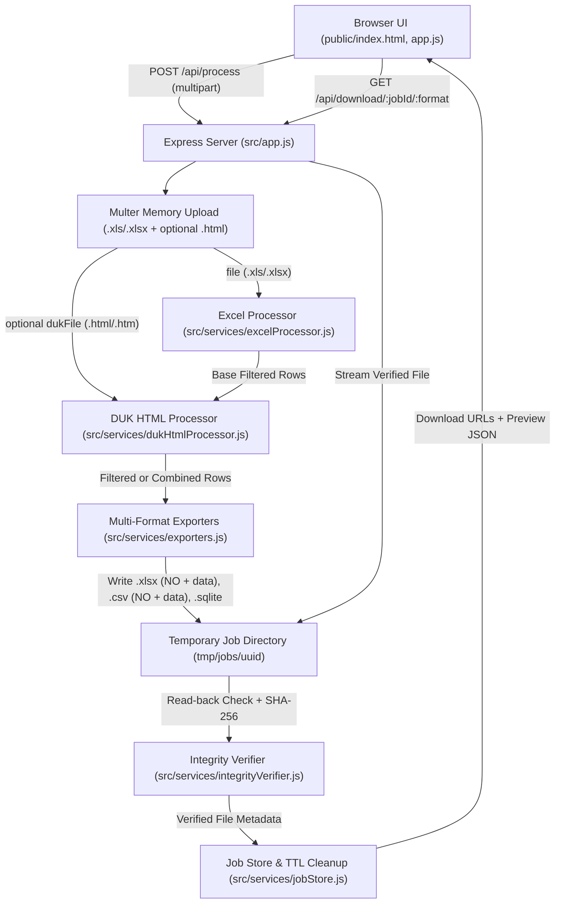
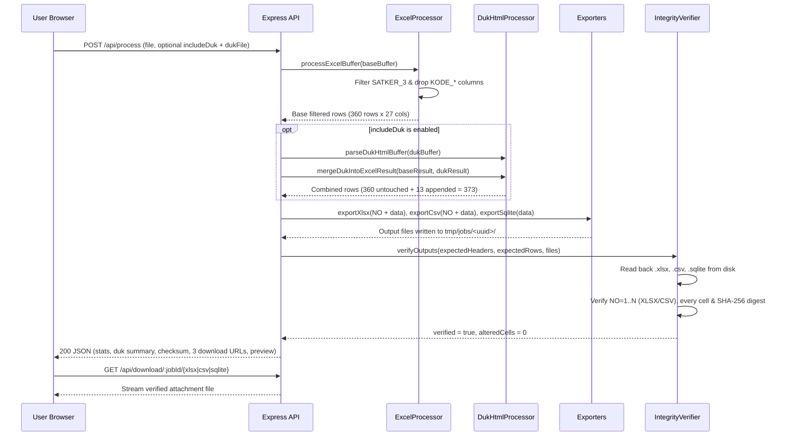

# System Architecture: `kmngfilterdata-metro`

## 1. High-Level Architecture

The application follows a minimal, modular monolith pattern built on Node.js and Express with zero frontend build tooling and built-in SQLite (`node:sqlite`).



## 2. Component Breakdown

| File | Responsibility |
| --- | --- |
| `src/config.js` | Centralizes filter rules (`SATKER_3`, `"Kantor Kementerian Agama Kota Metro"`, `/^KODE_/i`), allowed `.xls`/`.xlsx`/`.html`/`.htm` extensions, file limits, TTL, and port overrides. |
| `src/server.js` | Application entrypoint; starts Express listener, TTL cleanup scheduler, and graceful `SIGINT`/`SIGTERM` handlers. |
| `src/app.js` | Configures static file serving (`public/`), `multer` dual-field memory upload validation (`file`, `dukFile`), `/api/health`, `/api/process`, `/api/download/:jobId/:format`, and JSON error handling. |
| `src/services/excelProcessor.js` | Parses BIFF8 `.xls` and `.xlsx` buffers via SheetJS (`raw: true, cellDates: false`), validates `SATKER_3`, filters matching rows, drops `KODE_*` columns, and extracts canonical exact strings + raw cell descriptors. |
| `src/services/dukHtmlProcessor.js` | Parses DUK-SISDM HTML tables, validates DUK structure, extracts 14-column employee records, deduplicates against base Excel rows by `NIP_BARU` / `NIP`, and appends missing employees mapped into the retained schema. |
| `src/services/exporters.js` | Writes three independent output artifacts: `.xlsx` (Column A `NO` `1..N` + explicit string data cells), `.csv` (Column A `NO` `1..N` + RFC 4180 + UTF-8 BOM), and `.sqlite` (`node:sqlite` single-file database). |
| `src/services/integrityVerifier.js` | Reads back each generated `.xlsx`, `.csv`, and `.sqlite` file from disk, validates headers, sequential `NO` (`1..N`) in XLSX/CSV, row counts, `SATKER_3` predicate, absence of `KODE_*`, cell-by-cell equality, and length-framed SHA-256 checksums. |
| `src/services/jobStore.js` | Creates UUID-isolated job directories under `tmp/jobs/`, enforces UUID format validation, serves metadata until TTL expiration, and prunes stale directories. |
| `src/utils/csv.js` | Zero-dependency RFC 4180 CSV serializer and state-machine parser preserving leading zeros, commas, quotes, newlines, and whitespace. |
| `public/` | Static HTML/CSS/JS frontend providing auto-upload on single Excel upload, optional DUK HTML checkbox + dual dropzone flow, KPI cards, DUK merge summary, integrity banner, 3 download buttons, column audit chips, and searchable paginated preview. |

## 3. Data Processing & Integrity Pipeline



## 4. Zero-Mutation & Merge Engineering Decisions

1. **BIFF8 `.xls` and `.xlsx` Parsing (`SheetJS`)**:
   - Opened with `{ type: 'buffer', raw: true, cellDates: false, cellNF: true, cellStyles: false, cellFormula: false }`.
   - Prevents SheetJS from coercing mixed date strings or floating-point rounding long IDs.
2. **DUK HTML Deduplication & Non-Destructive Append**:
   - Base Excel filtered rows are shallow-copied and never modified or overwritten by DUK HTML fields (base Excel carries richer fields such as `AGAMA`, `STATUS_KAWIN`, `TMT_CPNS`, and `GRUP_SATUAN_KERJA`).
   - Deduplication matches primarily on `NIP_BARU` (18-digit employee ID) and falls back to `NIP`. Both Excel-to-DUK and intra-DUK duplicates are ignored.
   - `TMT_JABATAN` and `TMT_PENSIUN` from DUK (`DD-MM-YYYY`) are normalized to `YYYY-MM-DD` to match the exact format of those columns in the base Excel file, while `TMT_PANGKAT` stays `DD-MM-YYYY`.
3. **Sequential Column A (`NO`: `1..N`) in XLSX & CSV**:
   - `exportXlsx` writes Column `A` (`NO` header as string, row values `1..N` as numeric `{ t: 'n', v: r + 1 }`) and shifts data columns to `B`..`AB`.
   - `exportCsv` prepends `'NO'` and `String(r + 1)` to every serialized row.
   - `exportSqlite` keeps the exact 27 data columns (`rowid` serves as SQLite's built-in row ID).
4. **18-Digit Identifier (`NIP_BARU`) Protection**:
   - In `XLSX`, string data cells are written explicitly as `{ t: 's', v: val }` rather than relying on auto-typing.
   - In `SQLite`, all columns use `TEXT NOT NULL` inside a single transaction with `PRAGMA journal_mode = DELETE;` (no `-wal`/`-shm` sidecars).
   - In `CSV`, exact values are serialized under RFC 4180 quoting with UTF-8 BOM.
5. **Canonical SHA-256 Read-Back Verification**:
   - `computeCanonicalHash(headers, rows)` feeds length-prefixed header and cell byte strings (`${Buffer.byteLength(val)}:${val}\0`) into SHA-256.
   - For `.xlsx` and `.csv`, `verifyOutputs` asserts `Column A === 'NO'` and `row[0] === String(r + 1)`, then verifies the canonical SHA-256 digest of columns `B..` equals the expected dataset digest and the `.sqlite` table digest.

## 5. HTTP API Specification

### `GET /api/health`
- **Response `200 OK`**:
  ```json
  { "status": "ok", "nodeVersion": "v25.9.0" }
  ```

### `POST /api/process`
- **Request**: `multipart/form-data`:
  - `file` (required): `.xls` or `.xlsx` base Excel workbook
  - `includeDuk` (optional): `'true'` when merging a DUK support file
  - `dukFile` (required when `includeDuk=true`): `.html` or `.htm` DUK-SISDM export
- **Response `200 OK`**:
  - `jobId`, `sourceFile`, `sheetName`, `tableName`
  - `filter`: `{ column, columnLetter, query }`
  - `stats`: `{ totalSourceRows, baseExcelFilteredRows, addedFromDukCount, filteredRowCount, excludedRowCount, originalColumnCount, outputColumnCount, removedColumnCount, processingTimeMs }`
  - `duk`: `{ enabled: false }` or `{ enabled: true, sourceFile, satkerTitle, totalDukRows, alreadyInExcelCount, addedFromDukCount, addedPeople }`
  - `columns`: `{ kept, removed }`
  - `integrity`: `{ verified, algorithm, checksum, checkedRows, checkedColumns, alteredCells, rowNumberFormats, formats }`
  - `downloads`: `{ xlsx, csv, sqlite }` (each `{ url, filename, bytes }`)
  - `preview`: `{ headers, rows, totalRows }` (up to 500 rows)
- **Error Responses**:
  - `400 Bad Request`: missing file, unsupported extension, malformed Excel/HTML, missing `SATKER_3`, or `includeDuk=true` without `dukFile`.
  - `413 Payload Too Large`: file exceeds `MAX_FILE_SIZE_BYTES`.
  - `500 Internal Server Error`: unexpected processing or integrity error.

### `GET /api/download/:jobId/:format`
- **Parameters**: `jobId` (UUID v4), `format` (`xlsx` | `csv` | `sqlite`).
- **Response `200 OK`**: Binary/text stream with explicit `Content-Type`, `Content-Length`, `Content-Disposition: attachment; filename="..."`, and `Cache-Control: no-store`.
- **Error Responses**: `400 Bad Request` (invalid UUID or format), `404 Not Found` (unknown or expired job).

## 6. Security & Lifecycle Controls

- **Path Traversal Prevention**: Download `jobId` is validated against strict UUID v4 regex before lookup; download filenames are sanitized via `sanitizeFileBase`.
- **Memory & Disk Bounds**: Uploaded files are capped by `multer` size and field-count limits (`files: 2`), and generated job directories under `tmp/jobs/` are removed automatically after `JOB_TTL_MINUTES` (default 60 minutes) or immediately on export error.
- **XSS Prevention**: `public/app.js` renders all filenames, DUK added employee names, headers, and cell values exclusively via `.textContent` (never `innerHTML`).
