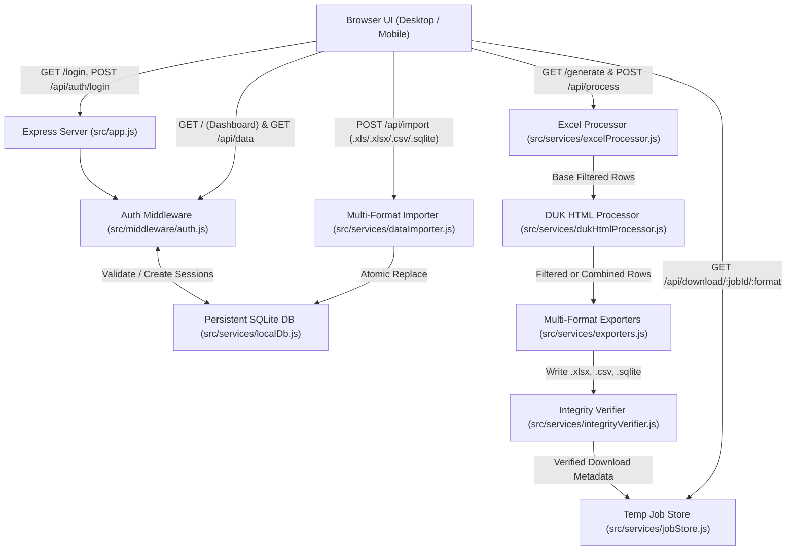
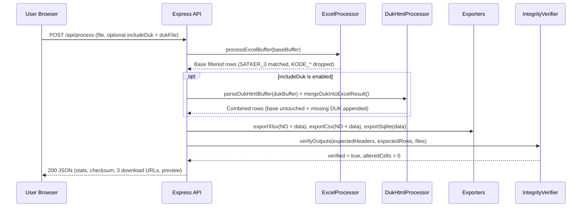

# System Architecture: `kmngfilterdata-metro`

## 1. High-Level Architecture

The application is a lightweight Node.js + Express monolith using server-protected HTML views (`views/`), static assets (`public/`), and Node's built-in `node:sqlite` for both persistent storage (`data/kmng_metro.sqlite`) and `.sqlite` exports.



## 2. Component Breakdown

| File | Responsibility |
| --- | --- |
| `src/config.js` | Centralizes `APP_PASSWORD`, `DB_PATH`, session cookie settings, filter rules (`SATKER_3`, `"Kantor Kementerian Agama Kota Metro"`, `/^KODE_/i`), allowed extensions, upload size limits, and TTLs. |
| `src/server.js` | Application entrypoint; starts Express listener, TTL job cleanup scheduler, and closes both HTTP server and `localDb` on `SIGINT`/`SIGTERM`. |
| `src/middleware/auth.js` | Parses `Cookie` headers, performs constant-time SHA-256 password verification (`crypto.timingSafeEqual`), manages per-IP login rate limiting, and provides `requirePageAuth` (`302 /login`) and `requireApiAuth` (`401`). |
| `src/services/localDb.js` | Manages the persistent SQLite database (`data/kmng_metro.sqlite` in `WAL` mode) containing `_sessions`, `_dataset_meta`, and `pegawai_data`, including atomic dataset replacement and SQL `LIKE` search filtering. |
| `src/services/dataImporter.js` | Parses uploaded `.xls`, `.xlsx`, `.csv`, and `.sqlite`/`.db` files into normalized columns and string rows, automatically stripping a leading `NO` column so exported files re-import cleanly. |
| `src/app.js` | Serves static CSS/JS (`public/`, `index: false`), protects HTML views (`views/`), exposes auth endpoints, `/api/data`, `/api/import`, `/api/process`, and `/api/download/:jobId/:format`. |
| `src/services/excelProcessor.js` | Parses BIFF8 `.xls` and `.xlsx` buffers via SheetJS (`raw: true, cellDates: false`), validates `SATKER_3`, filters matching rows, and drops `KODE_*` columns. |
| `src/services/dukHtmlProcessor.js` | Parses DUK-SISDM HTML tables, deduplicates against base Excel rows by `NIP_BARU` / `NIP`, and appends missing employees mapped into the retained schema. |
| `src/services/exporters.js` | Writes `.xlsx` (Column A `NO` `1..N` + explicit string cells), `.csv` (Column A `NO` `1..N` + RFC 4180 + UTF-8 BOM), and `.sqlite` (`node:sqlite` single-file database). |
| `src/services/integrityVerifier.js` | Reads back generated `.xlsx`, `.csv`, and `.sqlite` files from disk and verifies sequential `NO`, headers, `SATKER_3` predicate, cell-by-cell equality, and canonical SHA-256 digests. |
| `src/services/jobStore.js` | Manages UUID-isolated temporary export directories under `tmp/jobs/` and TTL expiration cleanup. |
| `views/` & `public/` | Server-gated HTML views (`login.html`, `dashboard.html`, `generate.html`) and mobile-responsive client scripts (`login.js`, `dashboard.js`, `generate.js`, `styles.css`). |

## 3. Core Flows

### 3.1 Authentication & Persistent Dashboard Import

```mermaid
sequenceDiagram
    participant U as User Browser
    participant A as Auth & Express API
    participant I as DataImporter
    participant D as LocalDatabase (SQLite)

    U->>A: GET /
    A-->>U: 302 Redirect /login (when unauthenticated)
    U->>A: POST /api/auth/login { password }
    A->>A: timingSafeEqual(SHA256(input), SHA256(APP_PASSWORD))
    A->>D: createSession()
    A-->>U: 200 OK + Set-Cookie (HttpOnly; SameSite=Lax)
    U->>A: GET / & GET /api/data
    A->>D: getDataset()
    D-->>A: { hasData, meta, columns, rows }
    A-->>U: Render word-wrapped click-to-copy table
    U->>A: POST /api/import (file: .xls/.xlsx/.csv/.sqlite)
    A->>I: parseImportBuffer(buffer, filename)
    I-->>A: Normalized { sourceFormat, columns, rows }
    A->>D: replaceDataset() [BEGIN IMMEDIATE ... COMMIT]
    A-->>U: 200 OK { meta, totalRows }
```

### 3.2 Excel + DUK HTML Filter & Export Pipeline (`/generate`)



## 4. Key Engineering Decisions

1. **HTML View Isolation (`views/` vs `public/`)**:
   - All HTML templates (`login.html`, `dashboard.html`, `generate.html`) live outside `public/` and are served only through authenticated Express handlers (`requirePageAuth`). `express.static` serves `public/` with `{ index: false }`, preventing direct URL access to protected views without a session cookie.
2. **Zero-Mutation Persistence (`node:sqlite`)**:
   - Both the persistent server database (`data/kmng_metro.sqlite`, `WAL` mode) and exported `.sqlite` files (`DELETE` journal mode) store all imported columns as `TEXT NOT NULL` so 18-digit `NIP_BARU` values, leading zeros, negative integers, and mixed date strings are never coerced.
   - `LocalDatabase.replaceDataset` wraps `DROP TABLE IF EXISTS pegawai_data` + `CREATE TABLE` + batch inserts + `_dataset_meta` update in an atomic `BEGIN IMMEDIATE ... COMMIT` transaction.
3. **Scrollable, Non-Resizeable, Word-Wrapped Click-to-Copy Table**:
   - The dashboard table uses `table-layout: fixed`, explicit `<colgroup>` widths, `resize: none`, `white-space: normal`, `overflow-wrap: anywhere`, and sticky `<thead>` headers.
   - Click/tap and keyboard (`Enter`/`Space`) copy delegation uses `navigator.clipboard.writeText` with a `<textarea>` + `document.execCommand('copy')` fallback so copying works on mobile phones over plain HTTP LANs.
4. **Canonical SHA-256 Read-Back Verification**:
   - Generated `.xlsx`, `.csv`, and `.sqlite` exports are re-parsed from disk and checked cell-for-cell against the filtered/combined rows (`verifyOutputs`) before returning download links.

## 5. HTTP API Specification

- `GET /api/health` (Public): `{ "status": "ok", "nodeVersion": "v25.9.0" }`
- `GET /api/auth/status` (Public): `{ "authenticated": boolean }`
- `POST /api/auth/login` (Public): JSON `{ "password": "..." }` -> `200 { "ok": true }` + `Set-Cookie`, `401` on invalid password, `429` on rate limit.
- `POST /api/auth/logout` (Public): Revokes session token in SQLite and clears cookie (`200 { "ok": true }`).
- `GET /api/data?q=<query>` (Auth): Returns `{ hasData, meta, columns, rows, totalRows, filteredRows }`.
- `POST /api/import` (Auth): `multipart/form-data` (`file`: `.xls`/`.xlsx`/`.csv`/`.sqlite`/`.db`) -> `200 { ok: true, meta, columns, totalRows }`.
- `POST /api/process` (Auth): `multipart/form-data` (`file`, optional `includeDuk=true`, optional `dukFile`) -> `200` JSON with `stats`, `duk`, `integrity`, `downloads`, and `preview`.
- `GET /api/download/:jobId/:format` (Auth): Streams verified `xlsx`, `csv`, or `sqlite` file with `Content-Disposition: attachment`.

## 6. Security Controls

- **Password & Session Security**: Password checked via SHA-256 + `crypto.timingSafeEqual`; 256-bit random hex tokens persisted in SQLite `_sessions`; `HttpOnly; SameSite=Lax` cookie flag; per-IP failed login throttling (`25` failures per `15` minutes).
- **Path Traversal & File Bounds**: Download `jobId` validated against strict UUID v4 regex; `multer` limits uploads to `100 MB` default; SQLite identifiers quoted via `quoteIdent` and `LIKE` wildcards escaped.
- **XSS Prevention**: All client scripts (`login.js`, `dashboard.js`, `generate.js`) render dynamic text strictly via `.textContent`.
